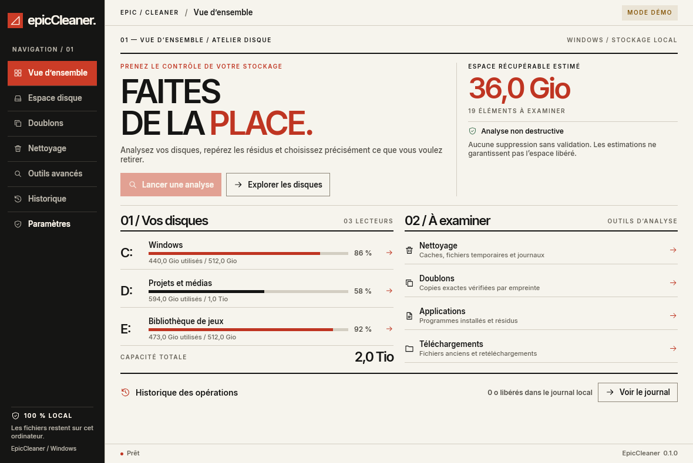
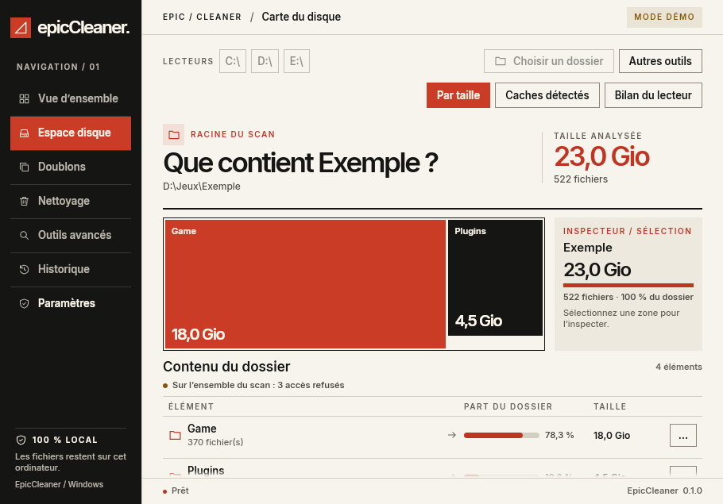
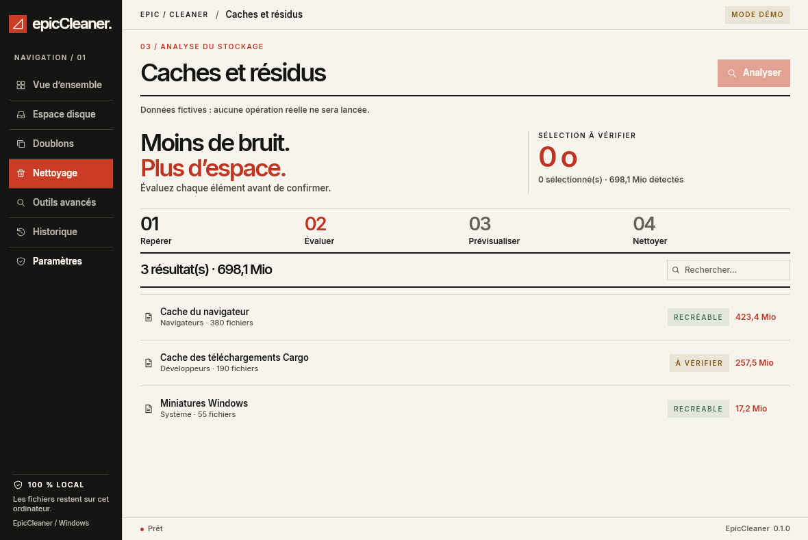

# EpicCleaner

**Comprenez ce qui remplit votre disque. Faites de la place sans supprimer à l’aveugle.**

**See what’s filling your drive. Free up space without guessing what to delete.**

   [](https://github.com/EpicPick/EpicCleaner/actions/workflows/windows.yml)

[🇫🇷 Français](#français) · [🇬🇧 English](#english)



## Français

EpicCleaner est un analyseur d’espace disque et un outil de nettoyage pour **Windows 10 et 11**. La carte du disque montre quels dossiers occupent le plus de place ; les outils de nettoyage aident ensuite à distinguer ce qui peut être recréé de ce qui mérite d’être conservé. L’application est écrite en Rust, avec une interface native [Rune](https://github.com/anomalyco/rune), sans WebView ni télémétrie.

### Télécharger et démarrer

1. Dans les [Releases GitHub](https://github.com/EpicPick/EpicCleaner/releases/latest), téléchargez `EpicCleaner-Windows-x64.zip`.
2. Extrayez l’archive, lancez `EpicCleaner.exe`, puis choisissez un lecteur ou un dossier.
3. Lancez une analyse, vérifiez les résultats et prévisualisez la sélection avant tout nettoyage.

Le ZIP ne nécessite pas d’installation. L’exécutable n’est pas signé ; Windows peut afficher un avertissement SmartScreen. Pour garder les réglages et l’historique à côté de l’exécutable, créez un fichier nommé `portable` (sans extension) : ils seront stockés dans le dossier `data`.

### Ce que vous pouvez faire

| Outil | À quoi il sert |
| --- | --- |
| **Carte du disque** | Explorer les dossiers par taille, repérer les caches et comparer l’espace utilisé, libre et analysé. Des droits insuffisants peuvent limiter certains résultats. |
| **Caches et résidus** | Examiner les caches de Windows, des navigateurs, des applications, des outils de développement et des jeux. L’export PowerShell relance un aperçu ; il ne supprime rien à lui seul. |
| **Gros fichiers et doublons** | Filtrer par taille et repérer les copies exactes au sein d’un même dossier, y compris dans les sous-dossiers analysés. Une copie est conservée et les contenus sont revérifiés avant le retrait. |
| **Téléchargements et dossiers vides** | Repérer les installateurs, les retéléchargements probables et les dossiers vides. Le retrait d’un dossier vide revérifie son contenu et ne supprime aucun fichier. |
| **Développement, IA et jeux** | Repérer les artefacts de compilation, inventorier les modèles d’IA et les bibliothèques Steam, et identifier les caches de shaders. Les modèles Ollama sont retirés via l’outil officiel. |
| **Applications et outils Windows** | Utiliser les désinstallateurs officiels, rechercher des résidus et accéder aux outils Windows (Corbeille, DISM, veille prolongée, etc.). |

> **Avant de confirmer :** les nettoyages du moteur passent par un aperçu et une confirmation. Certaines opérations système intégrées demandent l’autorisation Windows (UAC). Les règles personnalisées dans `%APPDATA%\EpicCleaner\rules` ne peuvent ni lancer de commandes ni demander l’élévation. L’historique des nettoyages du moteur reste local.

L’interface est actuellement **en français**. Il n’y a pas d’installateur, de paquet Linux ni de mise à jour automatique.

<details>
<summary>Voir la carte du disque et l’écran de nettoyage (données fictives)</summary>




</details>

### Compiler depuis les sources

Prérequis : Windows, Rust stable, Git et les outils de compilation C++ de Visual Studio avec le SDK Windows.

```powershell
cargo run --locked
cargo test --workspace --locked
cargo build --release --locked
```

L’exécutable compilé se trouve dans `target\release\epic-cleaner.exe`. Pour signaler un problème, [ouvrez un ticket](https://github.com/EpicPick/EpicCleaner/issues) avec votre version de Windows et les étapes pour le reproduire. Masquez vos chemins et noms de fichiers personnels dans les captures et journaux.

## English

EpicCleaner is a disk space analyzer and cleanup tool for **Windows 10 and 11**. The disk map shows which folders are taking up the most space, and the cleanup tools help you distinguish files that can be regenerated from those worth keeping. It’s written in Rust with a native [Rune](https://github.com/anomalyco/rune) interface—no WebView, no telemetry.

### Download and get started

1. Download `EpicCleaner-Windows-x64.zip` from [GitHub Releases](https://github.com/EpicPick/EpicCleaner/releases/latest).
2. Extract the archive, run `EpicCleaner.exe`, then pick a drive or folder.
3. Run a scan, review the findings, and preview your selection before cleaning.

The ZIP requires no installation. The executable is unsigned, so Windows may show a SmartScreen warning. To keep settings and history next to the executable, create an extensionless file named `portable`. EpicCleaner will store them in a `data` folder beside the executable.

### What you can do

| Tool | What it does |
| --- | --- |
| **Disk map** | Browse folders by size, spot caches, and compare used, free, and scanned space. Some results may be limited by Windows permissions. |
| **Caches and leftovers** | Review Windows, browser, app, developer tool, and game caches. The PowerShell export reruns the preview; it doesn’t delete anything by itself. |
| **Large and duplicate files** | Filter by size and find exact copies within the same folder, including scanned subfolders. One copy is kept and file contents are checked again before removal. |
| **Downloads and empty folders** | Find installers, likely repeat downloads, and empty folders. Empty-folder removal checks the contents again and does not delete any files. |
| **Development, AI, and games** | Find build artifacts, inventory AI models and Steam libraries, and spot shader caches. Ollama models are removed using Ollama’s official tool. |
| **Apps and Windows tools** | Run official uninstallers, look for leftovers, and access Windows tools such as the Recycle Bin, DISM, and hibernation controls. |

> **Before you confirm:** cleanup through the engine requires a preview and confirmation. Some built-in system operations trigger a Windows UAC prompt. Custom rules in `%APPDATA%\EpicCleaner\rules` cannot run commands or request elevation. The engine keeps its cleanup history locally.

The app interface is currently **French-only**. There is no installer, Linux package, or automatic updater.

### Build from source

Requirements: Windows, stable Rust, Git, and Visual Studio C++ Build Tools with the Windows SDK.

```powershell
cargo run --locked
cargo test --workspace --locked
cargo build --release --locked
```

The release executable is `target\release\epic-cleaner.exe`. To report a problem, [open an issue](https://github.com/EpicPick/EpicCleaner/issues) with your Windows version and steps to reproduce it. Redact personal paths and filenames in screenshots and logs.

## Notices de licence / License notices

Le moteur et le catalogue de règles conservent leur [notice MIT](crates/disk-core/LICENSE). Les notices de l’interface Rune sont incluses dans l’archive Windows, dans `Licences/`.

The engine and rules catalog retain their [MIT notice](crates/disk-core/LICENSE). Rune’s notices are included in the Windows archive under `Licences/`.
